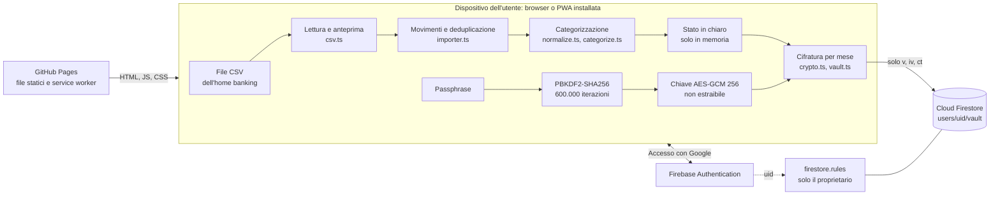

# RisparmIA

**Il portafoglio di famiglia che propone come risparmiare e verifica se ci stai riuscendo, con i dati cifrati sul tuo dispositivo.**

[](https://github.com/PZero/RisparmIA/actions/workflows/ci.yml)
[](https://github.com/PZero/RisparmIA/actions/workflows/pages.yml)
[](LICENSE)
[](#roadmap)

RisparmIA è una Progressive Web App in italiano: importi l'estratto conto dell'home banking, le spese vengono classificate da sole e la dashboard mostra dove vanno i soldi rispetto al tuo "solito". I movimenti vengono cifrati nel browser prima di arrivare su Firebase: il server conserva solo blob illeggibili.

- **App online:** <https://pzero.github.io/RisparmIA/> (senza account si può provare la **modalità demo** con dati inventati)
- **Stato:** Fase 1 (MVP "vedo i miei soldi"), versione `0.1.0`. Il motore delle strategie di risparmio arriva in Fase 2.

---

## Indice

- [Perché esiste](#perché-esiste)
- [Funzionalità](#funzionalità)
- [Privacy e sicurezza](#privacy-e-sicurezza)
- [Architettura](#architettura)
- [Avvio rapido](#avvio-rapido)
- [Esportare il CSV da UniCredit](#esportare-il-csv-da-unicredit)
- [Quanto si può risparmiare](#quanto-si-può-risparmiare)
- [Roadmap](#roadmap)
- [Sviluppo](#sviluppo)
- [Subagenti Claude Code](#subagenti-claude-code)
- [Licenza e avvertenze](#licenza-e-avvertenze)

## Perché esiste

Le app di gestione delle spese di solito si fermano al monitoraggio: grafici a torta che si guardano una volta e poi si dimenticano. RisparmIA nasce con un obiettivo diverso, il **risparmio attivo**:

1. capire dove vanno i soldi, con il minimo lavoro manuale (Fase 1);
2. ricevere proposte concrete, ciascuna con una stima in euro e un grado di affidabilità dichiarato (Fase 2);
3. accettare un piano e verificare mese per mese il risparmio **previsto contro quello realizzato**, ricalibrando quando un piano non funziona (Fase 2).

Tutto questo senza consegnare a terzi l'elenco dei propri acquisti: i dati sono cifrati end-to-end e la chiave non lascia mai il dispositivo.

## Funzionalità

### Disponibili (Fase 1)

| Area | Cosa fa | Dove nel codice |
|---|---|---|
| Import CSV | Legge l'estratto conto UniCredit (e CSV bancari italiani simili) solo nel browser, mostra un'anteprima con le colonne riconosciute e importa dopo conferma | `src/lib/csv.ts`, `src/views/Import.tsx` |
| Deduplicazione | Reimportare lo stesso periodo non crea doppioni; due movimenti identici nello stesso giorno restano distinti | `src/lib/importer.ts` |
| Categorizzazione automatica | 21 categorie; priorità: regole dell'utente → tipo di operazione (stipendio, commissioni, prelievi, saldo carta) → dizionario esercenti → tipo generico → "Da classificare" | `src/lib/categorize.ts`, `src/lib/categories.ts`, `src/lib/normalize.ts` |
| Apprendimento | Correggendo una categoria si può creare una regola sull'esercente, applicata subito a tutti i movimenti simili; le regole si gestiscono dalle Impostazioni | `src/state.ts` (`setCategory`), `src/views/Settings.tsx` |
| Dashboard | Entrate, spese e rimanenza del mese; spesa per categoria confrontata con la spesa "abituale" (mediana dei 3, 6 o 12 mesi precedenti); andamento degli ultimi 12 mesi; esercenti principali | `src/lib/analytics.ts`, `src/views/Dashboard.tsx` |
| Obiettivo di risparmio | Quota delle entrate da mettere da parte (es. 15%), confrontata con il tasso di risparmio medio degli ultimi 1, 3, 6 o 12 mesi completi (media pesata sulle entrate); mostra quanto ridurre le uscite al mese per raggiungerlo, se ci si sta avvicinando e lo storico mensile | `src/lib/target.ts`, `src/components/TargetCard.tsx` |
| Movimenti | Elenco con ricerca per esercente o descrizione, filtri per mese e categoria, ricategorizzazione | `src/views/Transactions.tsx` |
| Cifratura lato client | AES-GCM 256 con chiave derivata dalla passphrase tramite PBKDF2-SHA256 (600.000 iterazioni) | `src/lib/crypto.ts` |
| Sincronizzazione | Archivio cifrato su Cloud Firestore, un documento per mese; cache locale persistente per l'uso offline (contiene solo blob cifrati) | `src/lib/vault.ts`, `src/lib/firebase.ts` |
| Backup | Esportazione e ripristino di un backup cifrato con la stessa passphrase | `src/state.ts` (`exportBackup`, `importBackup`) |
| Blocco automatico | Dopo 10 minuti di inattività la chiave viene dimenticata e serve di nuovo la passphrase | `src/App.tsx` |
| Modalità demo | Dati sintetici generati in locale, nessun accesso e nessun salvataggio; scaricabile anche un CSV di esempio | `src/lib/demo.ts` |
| PWA | Installabile su telefono e desktop, aggiornamento automatico del service worker | `vite.config.ts` |

### In arrivo

| Funzionalità | Fase |
|---|---|
| Motore strategie di risparmio: rilevatori (abbonamenti ricorrenti, commissioni, utenze, assicurazioni, piccole spese frequenti, spesa alimentare, "paga prima te stesso"), proposte con stima in euro e affidabilità | 2 |
| Piani accettati, previsione prudente e attesa, monitoraggio previsto contro realizzato | 2 |
| AI con la **chiave API Claude dell'utente**, conservata cifrata nel browser: classificazione degli esercenti ambigui e lettura delle foto degli scontrini con le singole righe di acquisto (il modello dati `ReceiptItem` in `src/lib/types.ts` è già predisposto) | 2 |
| Collegamento automatico al conto UniCredit tramite Enable Banking (PSD2) | 3 |

Non sono previsti, al momento: lettura diretta dei file Excel (vanno salvati come CSV), uso multi-utente o familiare con dati condivisi.

## Privacy e sicurezza

RisparmIA tratta dati finanziari personali e il suo codice è pubblico. Le scelte che seguono sono verificabili nei file citati; i dettagli e il modo di segnalare vulnerabilità sono in [SECURITY.md](SECURITY.md).

### Modello di minaccia in breve

L'obiettivo è che **chi controlla il server** (Google, chi amministra il progetto Firebase, chi ottiene accesso al database) **non possa leggere importi, descrizioni, esercenti né regole**. Non è un obiettivo proteggere i dati da un dispositivo già compromesso.

### Cifratura lato client

- Alla prima configurazione l'utente sceglie una passphrase (almeno 12 caratteri). Da questa, con un sale casuale di 16 byte per utente, si deriva con **PBKDF2-SHA256 a 600.000 iterazioni** una chiave **AES-GCM a 256 bit** non estraibile (`src/lib/crypto.ts`).
- Ogni cifratura usa un **IV casuale di 96 bit**. La passphrase non viene mai salvata: per verificarla si conserva solo un testo noto cifrato.
- La chiave vive in una variabile in memoria (`src/state.ts`): non finisce in `localStorage`, IndexedDB, log o rete. Viene dimenticata con il blocco manuale, il blocco automatico dopo 10 minuti e l'uscita dall'account.
- Il file CSV viene letto con l'API `File` del browser e non viene mai caricato.

### Cosa vede e cosa non vede il server

| Il server vede | Il server non vede |
|---|---|
| Identità Google dell'utente (uid ed email, tramite Firebase Authentication) | Importi, date dei singoli movimenti, descrizioni, esercenti |
| I nomi dei documenti: `settings`, `rules` e `tx-AAAA-MM`, quindi **quali mesi** contengono movimenti | Categorie, regole di categorizzazione, impostazioni |
| Dimensione dei documenti cifrati (indica approssimativamente quanti movimenti ci sono in un mese) e data dell'ultimo aggiornamento | La passphrase e la chiave |
| Sale, numero di iterazioni e verificatore cifrato (`users/{uid}/meta/crypto`), che non sono segreti | Il contenuto dei backup |

### Regole Firestore

Il file [`firestore.rules`](firestore.rules):

- consente lettura e scrittura solo al proprietario (`request.auth.uid == uid`) e nega tutto il resto;
- accetta nel vault solo documenti con i campi `v`, `iv`, `ct`, `updatedAt` (testo cifrato sotto 1 MB, `updatedAt` uguale all'ora del server) e solo con ID `settings`, `rules` o `tx-AAAA-MM`;
- valida la forma dei parametri di derivazione della chiave.

### Frontend

- Nessun servizio di analisi o tracciamento, nessun font o script da CDN.
- Content Security Policy in `index.html` limitata all'origine dell'app e ai domini Google e Firebase necessari per accesso e database; `referrer` disattivato.

### Limiti onesti

- **Passphrase persa, dati persi.** Nessuno, nemmeno lo sviluppatore, può recuperarli. L'unica mitigazione oggi è il backup cifrato; la "chiave di recupero" da stampare citata nella proposta non è ancora implementata.
- Chi controlla il dispositivo, il browser o il codice servito (per esempio una dipendenza compromessa o un deploy malevolo su GitHub Pages) può leggere i dati mentre l'archivio è sbloccato. La cifratura end-to-end protegge dal server, non da questo.
- GitHub Pages non permette intestazioni HTTP personalizzate: la CSP è impostata via meta tag, che non supporta `frame-ancestors`.
- La configurazione web di Firebase finisce nel bundle pubblico: non è un segreto per progetto, la protezione dei dati è affidata alle regole e alla cifratura.
- Con il collegamento bancario della Fase 3 i movimenti transiteranno in chiaro, solo in memoria, nella Cloud Function prima di essere cifrati. Con l'import da file non escono mai in chiaro dal dispositivo.

## Architettura

Frontend statico (Preact, TypeScript, Vite) pubblicato su GitHub Pages; Firebase fornisce solo autenticazione e archiviazione di blob cifrati. Non c'è un backend applicativo in Fase 1.



Struttura dei dati su Firestore (`src/lib/vault.ts`):

| Percorso | Contenuto |
|---|---|
| `users/{uid}/meta/crypto` | Sale, iterazioni, verificatore della passphrase (non segreti) |
| `users/{uid}/vault/settings` | Impostazioni, cifrate |
| `users/{uid}/vault/rules` | Regole di categorizzazione dell'utente, cifrate |
| `users/{uid}/vault/tx-AAAA-MM` | Movimenti di un mese, cifrati |

Al salvataggio vengono riscritti solo i documenti il cui contenuto è cambiato.

## Avvio rapido

### Provare la demo

Apri <https://pzero.github.io/RisparmIA/> e scegli **"Prova con dati di esempio"**. I movimenti sono generati in locale da `src/lib/demo.ts` e nulla viene salvato.

### Sviluppo locale

Requisiti: Node.js 20 o superiore (la CI usa Node 22) e Git.

```bash
git clone https://github.com/PZero/RisparmIA.git
cd RisparmIA
npm ci
git config core.hooksPath .githooks   # attiva il controllo anti-dati sensibili sui commit
npm run dev                           # http://localhost:5173
```

Senza configurazione Firebase l'app parte in sola modalità demo.

### Configurazione Firebase

1. Crea un progetto nella console Firebase e registra un'app web.
2. In **Authentication** abilita il provider **Google**. In *Impostazioni → Domini autorizzati* aggiungi `pzero.github.io` (o il dominio della tua copia; `localhost` è già incluso).
3. Crea un database **Cloud Firestore**.
4. Copia `.env.example` in `.env.local` (ignorato da git) e compila le variabili con i valori dell'SDK web:

   | Variabile | Obbligatoria |
   |---|---|
   | `VITE_FIREBASE_API_KEY` | sì |
   | `VITE_FIREBASE_PROJECT_ID` | sì |
   | `VITE_FIREBASE_APP_ID` | sì |
   | `VITE_FIREBASE_AUTH_DOMAIN` | sì, per l'accesso con Google |
   | `VITE_FIREBASE_MESSAGING_SENDER_ID` | consigliata |
   | `VITE_FIREBASE_STORAGE_BUCKET` | consigliata |

   L'app considera Firebase configurato quando sono presenti chiave API, ID progetto e ID app (`src/lib/firebase.ts`).

### Pubblicare le regole Firestore

Serve la [Firebase CLI](https://firebase.google.com/docs/cli) (`npm install -g firebase-tools`), che non è una dipendenza del progetto.

```bash
cp .firebaserc.example .firebaserc    # poi indica il tuo ID progetto (.firebaserc è ignorato da git)
firebase login
npm run deploy:rules                  # firebase deploy --only firestore
```

### Pubblicare su GitHub Pages

Il workflow [`pages.yml`](.github/workflows/pages.yml) esegue test e build a ogni push su `main` e pubblica `dist/`. Per abilitarlo:

1. *Settings → Pages → Build and deployment → Source*: **GitHub Actions**.
2. *Settings → Secrets and variables → Actions → **Variables***: crea le sei variabili `VITE_FIREBASE_*` elencate sopra. Sono variabili, non segreti, perché finiscono comunque nel bundle pubblico. Senza variabili la build pubblica la sola modalità demo.

La build per Pages imposta `VITE_BASE=/RisparmIA/`.

## Esportare il CSV da UniCredit

1. Accedi all'home banking UniCredit da computer e apri la lista movimenti del conto.
2. Scegli il periodo (anche più mesi insieme) ed esporta in **CSV**. Se è disponibile solo Excel, apri il file e salvalo come *CSV (delimitato da punto e virgola)*.
3. In RisparmIA apri **Importa**, scegli il file, controlla l'anteprima e conferma.

Per fare una prova senza dati reali, la schermata Importa offre un CSV di esempio con movimenti inventati.

### Formati supportati (`src/lib/csv.ts`)

| Aspetto | Supporto |
|---|---|
| Separatore | `;`, `,` o tabulazione, rilevato automaticamente |
| Codifica | UTF-8 (anche con BOM); se compaiono caratteri non validi, Windows-1252 |
| Intestazione | Cercata nelle prime 40 righe: le righe iniziali con i dati del conto vengono ignorate |
| Data | Colonna `Data registrazione`, `Data contabile`, `Data operazione` o `Data` (non `Data valuta`); formati `gg/mm/aaaa`, `gg.mm.aa`, `gg-mm-aaaa`, `aaaa-mm-gg` |
| Descrizione | Una o più colonne tra `Descrizione`, `Causale`, `Dettagli`, `Motivo`, `Beneficiario`, `Esercente`, unite nell'ordine del file |
| Importo | Colonna unica con segno (`Importo`, `Ammontare`, `Amount`) oppure colonne separate `Uscite`/`Dare`/`Addebiti` ed `Entrate`/`Avere`/`Accrediti` |
| Numeri | All'italiana (`-1.234,56`), con segno finale o tra parentesi, con o senza `€` |
| Righe ignorate | Saldi, totali, righe senza data, importo o descrizione (il numero viene mostrato nell'anteprima) |

Un esempio di file accettato, con dati inventati, è in [`tests/fixtures/entrate-uscite-sintetico.csv`](tests/fixtures/entrate-uscite-sintetico.csv).

## Quanto si può risparmiare

Una stima onesta, ripresa dalla [proposta di progetto](docs/PROPOSTA-PROGETTO.md#7-quanto-si-può-risparmiare-davvero). È un'**inferenza**, non un dato pubblicato né una promessa.

- Per una famiglia con spesa vicina alla media italiana (circa 2.750 € al mese secondo [ISTAT, spese per consumi delle famiglie, anno 2024](https://www.istat.it/comunicato-stampa/spese-per-consumi-delle-famiglie-anno-2024/)), il risparmio realistico nel **primo anno** è di circa il **3-6% della spesa mensile**, cioè 80-170 € al mese.
- Le leve principali sono la disdetta degli abbonamenti inutilizzati, la rinegoziazione di utenze, telefonia, assicurazioni e conto, e una riduzione moderata delle spese discrezionali. Oltre il 10% si arriva solo con decisioni strutturali (casa, auto, mutuo).
- Levi e Benartzi, *Mind the App*, riportano un calo medio della spesa del 15,7% tra gli utenti di un'app di aggregazione conti ([sintesi Wharton BCFG](https://bcfg.wharton.upenn.edu/newsletter-may-2019/)); il campione è auto-selezionato e l'effetto tende a calare, quindi va letto come **tetto massimo**.
- Carlin, Olafsson e Pagel, *Mobile Apps and Financial Decision Making* (Review of Finance, 2023), osservano un calo del 38% delle commissioni per fondi insufficienti in 24 mesi ([Review of Finance](https://revfin.org/?p=3045)): vedere i propri dati riduce soprattutto gli errori costosi.

La leva più efficace resta l'automazione: un bonifico verso un conto di risparmio il giorno dello stipendio fa sì che il risparmio previsto diventi reale.

## Roadmap

Ogni fase corrisponde a una [milestone su GitHub](https://github.com/PZero/RisparmIA/milestones). Il dettaglio delle scelte è in [docs/PROPOSTA-PROGETTO.md](docs/PROPOSTA-PROGETTO.md).

| Fase | Obiettivo | Stato |
|---|---|---|
| **1. MVP "vedo i miei soldi"** | Import CSV UniCredit, categorizzazione automatica, dashboard con obiettivo di risparmio, accesso Google, dati cifrati, PWA | Completata nella versione 0.1.0 |
| **2. Motore risparmi v1** | Rilevatori di opportunità, proposte con stima in euro, piani e monitoraggio previsto contro realizzato; AI con chiave Claude dell'utente per esercenti ambigui e scontrini | Prossima (richiede almeno 3 mesi di storico) |
| **3. Collegamento automatico UniCredit** | Sincronizzazione via Enable Banking (PSD2) con Cloud Functions, piano Firebase Blaze, chiave privata in Secret Manager; l'import da file resta disponibile | Pianificata |
| **4. Evoluzioni** | Notifiche e ulteriori miglioramenti, da definire | Da definire |

L'app è pensata per un solo utente: l'uso familiare con dati condivisi richiederebbe una diversa gestione delle chiavi e non è pianificato.

## Sviluppo

### Struttura

```text
.
├── .claude/agents/         Subagenti Claude Code del progetto
├── .githooks/pre-commit    Hook anti-dati sensibili
├── .github/                Workflow CI e Pages, Dependabot
├── docs/                   Proposta di progetto e documentazione
├── public/                 Icone della PWA
├── scripts/                check-sensitive.mjs
├── src/
│   ├── components/         Grafici e componenti condivisi
│   ├── lib/                Logica pura: CSV, categorizzazione, analisi, cifratura, archivio
│   ├── views/              Schermate: accesso, dashboard, movimenti, import, impostazioni
│   ├── App.tsx             Navigazione e blocco automatico
│   └── state.ts            Stato dell'app, chiave in memoria, backup
├── tests/                  Test Vitest e fixture sintetiche
├── firestore.rules         Regole di sicurezza del database
└── index.html              Pagina con Content Security Policy
```

### Script npm

| Comando | Cosa fa |
|---|---|
| `npm run dev` | Server di sviluppo Vite |
| `npm run build` | Controllo dei tipi e build di produzione in `dist/` |
| `npm run preview` | Anteprima locale della build |
| `npm test` | Test con Vitest |
| `npm run typecheck` | Solo controllo dei tipi TypeScript |
| `npm run deploy:rules` | Pubblica regole e indici Firestore (richiede Firebase CLI) |

### Test

I test in `tests/` coprono lettura del CSV, normalizzazione e categorizzazione, cifratura e verifica della passphrase, deduplicazione, statistiche mensili e calcolo dell'obiettivo di risparmio. Usano solo dati sintetici: le fixture stanno in `tests/fixtures/` e i movimenti demo sono generati da `src/lib/demo.ts`.

### Controllo anti-dati sensibili

Il repository è pubblico, quindi `scripts/check-sensitive.mjs` blocca IBAN validi, numeri di carta validi secondo Luhn, codici fiscali, chiavi private, token GitHub, chiavi API Google e Anthropic, file `.env` e file di movimenti (`.csv`, `.xlsx`, `.ofx`, `.qif`) fuori da `tests/fixtures/`.

- In locale gira come hook pre-commit dopo `git config core.hooksPath .githooks`.
- In CI ([`ci.yml`](.github/workflows/ci.yml)) gira su tutti i file tracciati, insieme alla scansione dei segreti con gitleaks, al controllo dei tipi, ai test e alla build.

### Convenzioni

Branch `feat/…`, `fix/…`, `docs/…`; `main` riceve solo Pull Request con CI verde; commit in stile [Conventional Commits](https://www.conventionalcommits.org/it/). I dettagli sono in [CONTRIBUTING.md](CONTRIBUTING.md), le modifiche in [CHANGELOG.md](CHANGELOG.md).

## Subagenti Claude Code

Il progetto usa [subagenti di Claude Code](https://docs.anthropic.com/en/docs/claude-code/sub-agents) con perimetri stretti, definiti in `.claude/agents/`.

| Subagente | Ruolo | Limiti | Disponibile |
|---|---|---|---|
| `repo-maintainer` | README, CHANGELOG, SECURITY, CONTRIBUTING, issue, milestone e note di rilascio, coerenza della documentazione con il codice | Non modifica codice applicativo, test, regole o configurazione di build | Sì |
| `privacy-guardian` | Revisione di sicurezza e privacy prima di commit e merge: dati reali, segreti, cifratura, regole Firestore, CSP | Solo lettura: segnala con un verdetto, non modifica file | Sì |
| `savings-strategist` | Progettazione e taratura dei rilevatori del motore risparmi, test su dati sintetici | Solo dataset finti | Fase 2 |
| `firebase-ops` | Configurazione Firebase, regole, emulatori, deploy, costi e quote | Nessuna cancellazione in produzione senza conferma | Fase 2 |

## Licenza e avvertenze

Distribuito con licenza [MIT](LICENSE).

RisparmIA è uno strumento personale di organizzazione delle spese. **Non è consulenza finanziaria, fiscale o di investimento**: le stime di risparmio sono indicative e le decisioni restano dell'utente. Il progetto non è affiliato a UniCredit, Google, Firebase o Anthropic; i nomi sono citati solo per descrivere le integrazioni.
